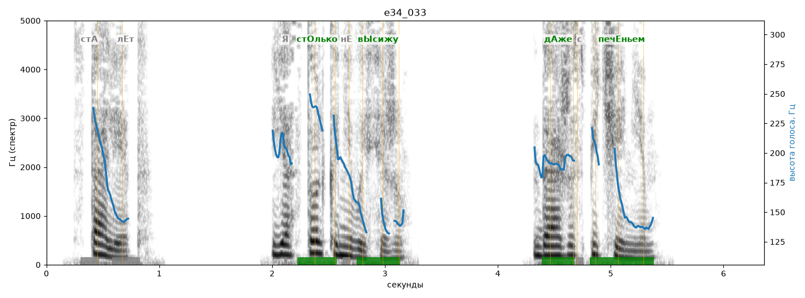

# e34_033

Голос: **edge:ru-RU-SvetlanaNeural** · длительность 6.4 с
Естественность (UTMOS): **4.02 из 5** (живой диктор ≈ 4–4.5)
Эталон: Ста лет? Я столько не высижу. Даже с печеньем.
Распознано: 100 лет. Я столько не высижу. Даже с печеньем.
Расхождения в словах: «ста» → «100»

## Ударения
(где нужно: ruaccent)

| слово | нужно | у голоса | |
|---|---|---|---|
| столько | стОлько | стОлько | ✓ |
| высижу | вЫсижу | вЫсижу | ✓ |
| даже | дАже | дАже | ✓ |
| печеньем | печЕньем | печЕньем | ✓ |

## Интонация
- ✓ «я столько не высижу.» — конец фразы понижается — звучит законченно
- ✓ «даже с печеньем.» — конец фразы понижается — звучит законченно
- Диапазон голоса 9.1 полутонов (живо), средняя высота 186 Гц

## Паузы и темп
- паузы на своих местах
- Темп 5.5 слога/с (нормально)

_Синяя линия — высота голоса. Над словами заглавная буква — где ударение должно быть; красным — голос поставил не туда (уверенно), оранжевым — возможно._
