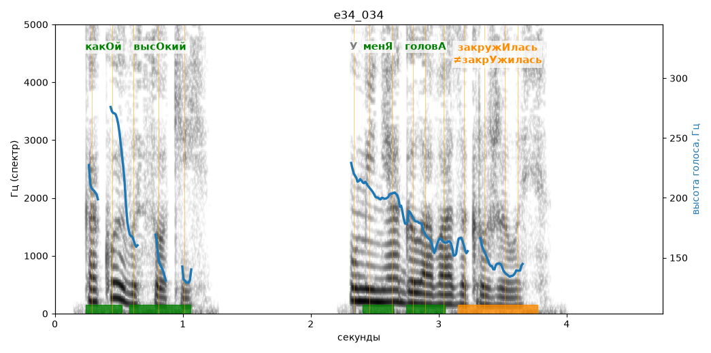

# e34_034

Голос: **edge:ru-RU-SvetlanaNeural** · длительность 4.8 с
Естественность (UTMOS): **3.74 из 5** (живой диктор ≈ 4–4.5)
Эталон: Какой высокий! У меня голова закружилась.
Распознано: Какой высокий? У меня голова закружилась.
Слова: все совпали

## Ударения
(где нужно: ruaccent)

| слово | нужно | у голоса | |
|---|---|---|---|
| какой | какОй | какОй | ✓ |
| высокий | высОкий | высОкий | ✓ |
| меня | менЯ | менЯ | ✓ |
| голова | головА | головА | ✓ |
| закружилась | закружИлась | закрУжилась | ✗? возможно — послушать |

## Интонация
- ✓ «какой высокий!» — выделено слово «какой» (+8.0 пт)
- ✓ «у меня голова закружилась.» — конец фразы понижается — звучит законченно
- Диапазон голоса 9.9 полутонов (живо), средняя высота 167 Гц

## Паузы и темп
- паузы на своих местах
- Темп 6.6 слога/с (быстро)

_Синяя линия — высота голоса. Над словами заглавная буква — где ударение должно быть; красным — голос поставил не туда (уверенно), оранжевым — возможно._
