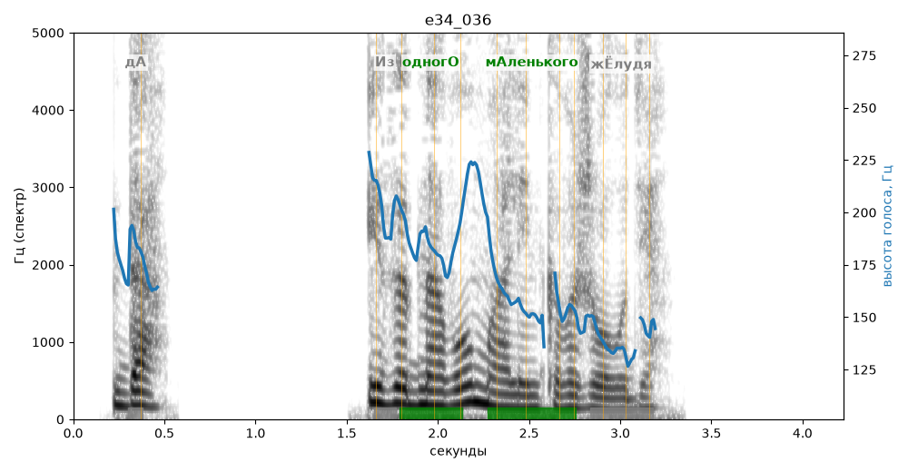

# e34_036

Голос: **edge:ru-RU-SvetlanaNeural** · длительность 4.2 с
Естественность (UTMOS): **3.88 из 5** (живой диктор ≈ 4–4.5)
Эталон: Да. Из одного маленького жёлудя.
Распознано: Да. Из одного маленького желудя.
Слова: все совпали

## Ударения
(где нужно: ruaccent)

| слово | нужно | у голоса | |
|---|---|---|---|
| одного | одногО | одногО | ✓ |
| маленького | мАленького | мАленького | ✓ |
| жёлудя | жЁлудя | жёлудЯ | ? не разобрать |

## Интонация
- ✓ «из одного маленького жёлудя.» — конец фразы понижается — звучит законченно
- Диапазон голоса 8.3 полутонов (живо), средняя высота 169 Гц

## Паузы и темп
- паузы на своих местах
- Темп 7.5 слога/с (быстро)

_Синяя линия — высота голоса. Над словами заглавная буква — где ударение должно быть; красным — голос поставил не туда (уверенно), оранжевым — возможно._
