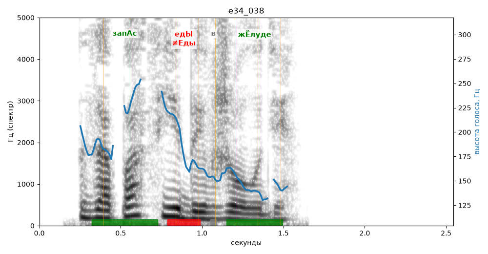

# e34_038

Голос: **edge:ru-RU-SvetlanaNeural** · длительность 2.5 с
Естественность (UTMOS): **4.12 из 5** (живой диктор ≈ 4–4.5)
Эталон: Запас еды в жёлуде.
Распознано: Запас еды в желуде.
Слова: все совпали

## Ударения
(где нужно: ruaccent)

| слово | нужно | у голоса | |
|---|---|---|---|
| запас | запАс | запАс | ✓ |
| еды | едЫ | Еды | ✗ ОШИБКА |
| жёлуде | жЁлуде | жЁлуде | ✓ |

## Интонация
- ✗ «запас еды в жёлуде.» — конец фразы не понижается — звучит незаконченно / как перечисление
- Диапазон голоса 9.5 полутонов (живо), средняя высота 164 Гц

## Паузы и темп
- паузы на своих местах
- Темп 6.8 слога/с (быстро)

_Синяя линия — высота голоса. Над словами заглавная буква — где ударение должно быть; красным — голос поставил не туда (уверенно), оранжевым — возможно._
