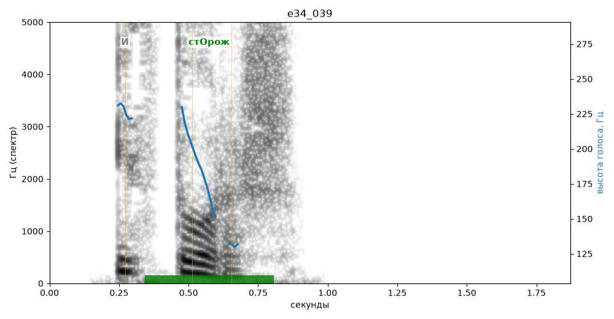

# e34_039

Голос: **edge:ru-RU-SvetlanaNeural** · длительность 1.9 с
Естественность (UTMOS): **3.73 из 5** (живой диктор ≈ 4–4.5)
Эталон: И сторож!
Распознано: Исторож.
Расхождения в словах: «и сторож» → «исторож»

## Ударения
(где нужно: ruaccent)

| слово | нужно | у голоса | |
|---|---|---|---|
| сторож | стОрож | стОрож | ✓ |

## Интонация
- ✓ «и сторож!» — выделено слово «и» (+2.7 пт)
- Диапазон голоса 9.7 полутонов (живо), средняя высота 195 Гц

## Паузы и темп
- паузы на своих местах
- Темп 5.5 слога/с (нормально)

_Синяя линия — высота голоса. Над словами заглавная буква — где ударение должно быть; красным — голос поставил не туда (уверенно), оранжевым — возможно._
