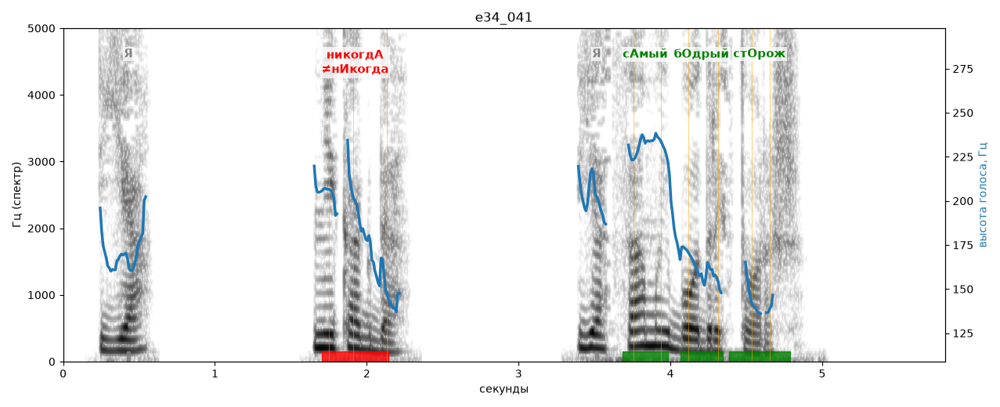

# e34_041

Голос: **edge:ru-RU-SvetlanaNeural** · длительность 5.8 с
Естественность (UTMOS): **4.0 из 5** (живой диктор ≈ 4–4.5)
Эталон: Я? Никогда. Я самый бодрый сторож.
Распознано: Я? Никогда. Я самый бодристорыш.
Расхождения в словах: «бодрый сторож» → «бодристорыш»

## Ударения
(где нужно: ruaccent)

| слово | нужно | у голоса | |
|---|---|---|---|
| никогда | никогдА | нИкогда | ✗ ОШИБКА |
| самый | сАмый | сАмый | ✓ |
| бодрый | бОдрый | бОдрый | ✓ |
| сторож | стОрож | стОрож | ✓ |

## Интонация
- ✓ «никогда.» — конец фразы понижается — звучит законченно
- ✓ «я самый бодрый сторож.» — конец фразы понижается — звучит законченно
- Диапазон голоса 9.0 полутонов (живо), средняя высота 176 Гц

## Паузы и темп
- паузы на своих местах
- Темп 5.7 слога/с (нормально)

_Синяя линия — высота голоса. Над словами заглавная буква — где ударение должно быть; красным — голос поставил не туда (уверенно), оранжевым — возможно._
