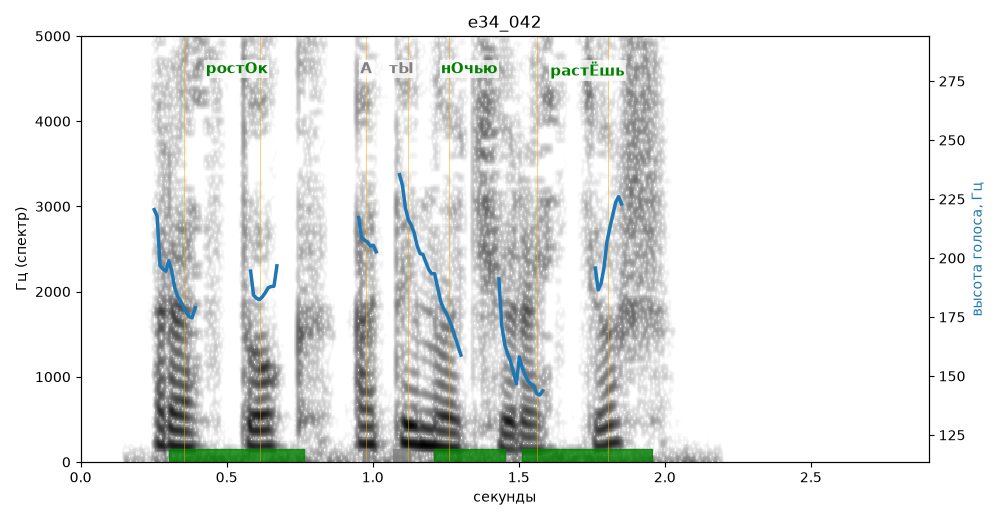

# e34_042

Голос: **edge:ru-RU-SvetlanaNeural** · длительность 2.9 с
Естественность (UTMOS): **3.74 из 5** (живой диктор ≈ 4–4.5)
Эталон: Росток, а ты ночью растёшь?
Распознано: Росток, а ты ночью растёшь?
Слова: все совпали

## Ударения
(где нужно: ruaccent)

| слово | нужно | у голоса | |
|---|---|---|---|
| росток | ростОк | ростОк | ✓ |
| ночью | нОчью | нОчью | ✓ |
| растёшь | растЁшь | растЁшь | ✓ |

## Интонация
- ✗ «росток а ты ночью растёшь?» — нет вопросительного подъёма (самое высокое место — «ты», в начале) — звучит как утверждение
- Диапазон голоса 7.3 полутонов (живо), средняя высота 188 Гц

## Паузы и темп
- паузы на своих местах
- Темп 4.8 слога/с (нормально)

_Синяя линия — высота голоса. Над словами заглавная буква — где ударение должно быть; красным — голос поставил не туда (уверенно), оранжевым — возможно._
