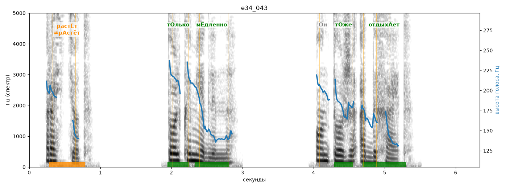

# e34_043

Голос: **edge:ru-RU-SvetlanaNeural** · длительность 6.3 с
Естественность (UTMOS): **3.66 из 5** (живой диктор ≈ 4–4.5)
Эталон: Растёт. Только медленно. Он тоже отдыхает.
Распознано: растет. Только медленно. Он тоже отдыхает.
Слова: все совпали

## Ударения
(где нужно: ruaccent)

| слово | нужно | у голоса | |
|---|---|---|---|
| растёт | растЁт | рАстёт | ✗? возможно — послушать |
| только | тОлько | тОлько | ✓ |
| медленно | мЕдленно | мЕдленно | ✓ |
| тоже | тОже | тОже | ✓ |
| отдыхает | отдыхАет | отдыхАет | ✓ |

## Интонация
- ✗ «только медленно.» — конец фразы не понижается — звучит незаконченно / как перечисление
- ✓ «он тоже отдыхает.» — конец фразы понижается — звучит законченно
- Диапазон голоса 8.0 полутонов (живо), средняя высота 175 Гц

## Паузы и темп
- паузы на своих местах
- Темп 5.4 слога/с (нормально)

_Синяя линия — высота голоса. Над словами заглавная буква — где ударение должно быть; красным — голос поставил не туда (уверенно), оранжевым — возможно._
