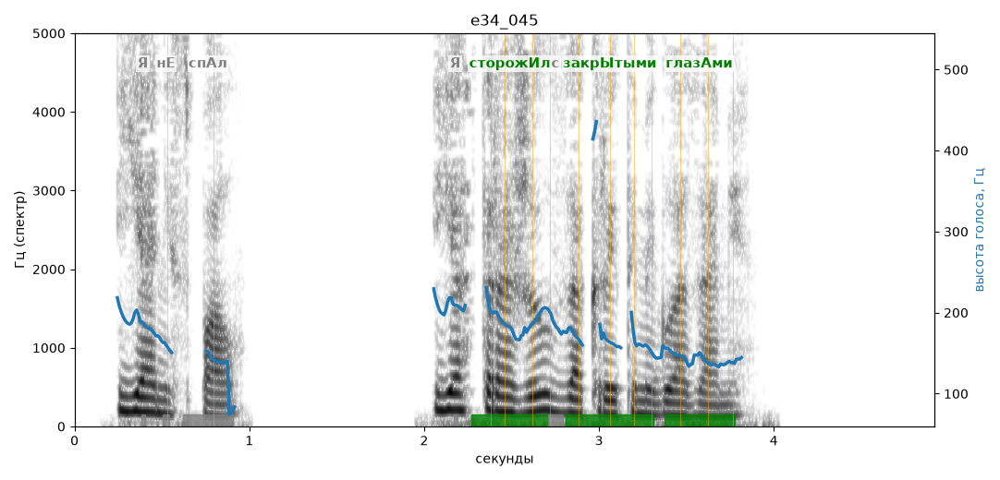

# e34_045

Голос: **edge:ru-RU-SvetlanaNeural** · длительность 4.9 с
Естественность (UTMOS): **3.97 из 5** (живой диктор ≈ 4–4.5)
Эталон: Я не спал! Я сторожил с закрытыми глазами!
Распознано: Я не спал. Я сторожил с закрытыми глазами.
Слова: все совпали

## Ударения
(где нужно: ruaccent)

| слово | нужно | у голоса | |
|---|---|---|---|
| сторожил | сторожИл | сторожИл | ✓ |
| закрытыми | закрЫтыми | закрЫтыми | ✓ |
| глазами | глазАми | глазАми | ✓ |

## Интонация
- ✓ «я сторожил с закрытыми глазами!» — выделено слово «с» (+2.6 пт)
- Диапазон голоса 7.8 полутонов (живо), средняя высота 168 Гц

## Паузы и темп
- паузы на своих местах
- Темп 6.1 слога/с (нормально)

_Синяя линия — высота голоса. Над словами заглавная буква — где ударение должно быть; красным — голос поставил не туда (уверенно), оранжевым — возможно._
