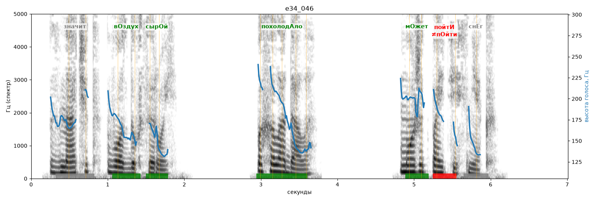

# e34_046

Голос: **edge:ru-RU-SvetlanaNeural** · длительность 7.0 с
Естественность (UTMOS): **3.89 из 5** (живой диктор ≈ 4–4.5)
Эталон: Значит, воздух сырой. Похолодало. Может пойти снег.
Распознано: Значит, воздух сырой. Похолодало. Может пойти снег.
Слова: все совпали

## Ударения
(где нужно: ruaccent)

| слово | нужно | у голоса | |
|---|---|---|---|
| значит | значит | знАчит | нет эталона |
| воздух | вОздух | вОздух | ✓ |
| сырой | сырОй | сырОй | ✓ |
| похолодало | похолодАло | похолодАло | ✓ |
| может | мОжет | мОжет | ✓ |
| пойти | пойтИ | пОйти | ✗ ОШИБКА |

## Интонация
- ✓ «значит воздух сырой.» — конец фразы понижается — звучит законченно
- ✓ «похолодало.» — конец фразы понижается — звучит законченно
- ✓ «может пойти снег.» — конец фразы понижается — звучит законченно
- Диапазон голоса 8.0 полутонов (живо), средняя высота 172 Гц

## Паузы и темп
- паузы на своих местах
- Темп 5.4 слога/с (нормально)

_Синяя линия — высота голоса. Над словами заглавная буква — где ударение должно быть; красным — голос поставил не туда (уверенно), оранжевым — возможно._
