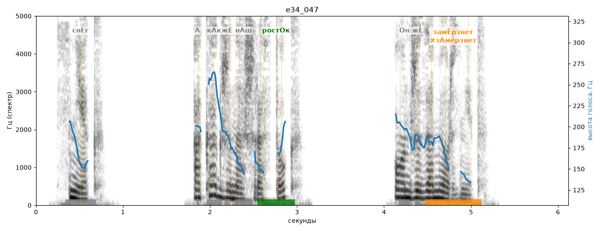

# e34_047

Голос: **edge:ru-RU-SvetlanaNeural** · длительность 6.1 с
Естественность (UTMOS): **3.99 из 5** (живой диктор ≈ 4–4.5)
Эталон: Снег? А как же наш росток? Он же замёрзнет!
Распознано: Снег. А как же наш расток? Он же замерзнет.
Расхождения в словах: «росток» → «расток»

## Ударения
(где нужно: ruaccent)

| слово | нужно | у голоса | |
|---|---|---|---|
| росток | ростОк | ростОк | ✓ |
| замёрзнет | замЁрзнет | зАмёрзнет | ✗? возможно — послушать |

## Интонация
- ✓ «а как же наш росток?» — вопросительный подъём на слове «как»
- ✗ «он же замёрзнет!» — восклицание звучит ровно, без эмоции
- Диапазон голоса 9.5 полутонов (живо), средняя высота 182 Гц

## Паузы и темп
- паузы на своих местах
- Темп 5.0 слога/с (нормально)

_Синяя линия — высота голоса. Над словами заглавная буква — где ударение должно быть; красным — голос поставил не туда (уверенно), оранжевым — возможно._
