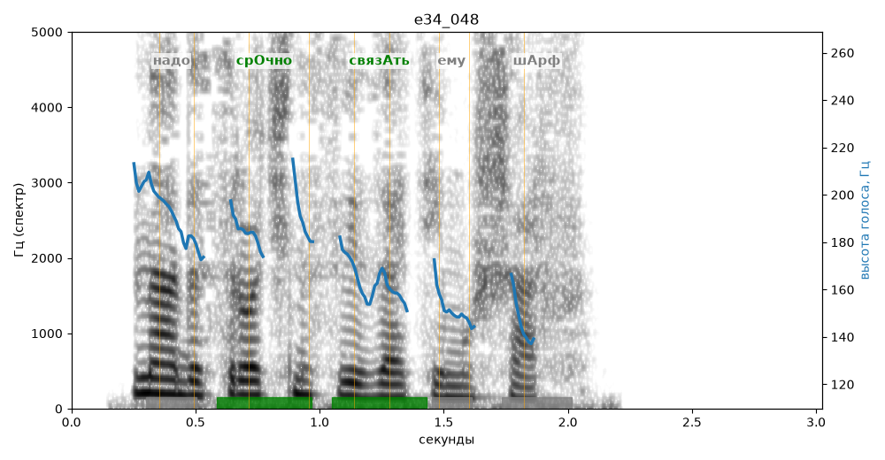

# e34_048

Голос: **edge:ru-RU-SvetlanaNeural** · длительность 3.0 с
Естественность (UTMOS): **3.82 из 5** (живой диктор ≈ 4–4.5)
Эталон: Надо срочно связать ему шарф!
Распознано: Надо срочно связать ему шарф.
Слова: все совпали

## Ударения
(где нужно: ruaccent)

| слово | нужно | у голоса | |
|---|---|---|---|
| надо | надо | нАдо | нет эталона |
| срочно | срОчно | срОчно | ✓ |
| связать | связАть | связАть | ✓ |
| ему | ему | емУ | нет эталона |

## Интонация
- ✓ «надо срочно связать ему шарф!» — выделено слово «надо» (+2.8 пт)
- Диапазон голоса 6.2 полутонов (нормально), средняя высота 174 Гц

## Паузы и темп
- паузы на своих местах
- Темп 5.3 слога/с (нормально)

_Синяя линия — высота голоса. Над словами заглавная буква — где ударение должно быть; красным — голос поставил не туда (уверенно), оранжевым — возможно._
