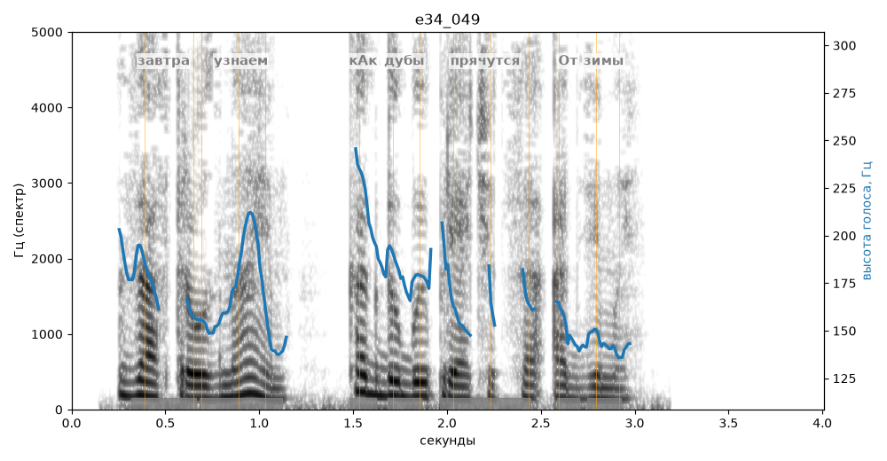

# e34_049

Голос: **edge:ru-RU-SvetlanaNeural** · длительность 4.0 с
Естественность (UTMOS): **3.96 из 5** (живой диктор ≈ 4–4.5)
Эталон: Завтра узнаем, как дубы прячутся от зимы.
Распознано: Завтра узнаем, как дубы прячется от зимы.
Расхождения в словах: «прячутся» → «прячется»

## Ударения
(где нужно: нет)

| слово | нужно | у голоса | |
|---|---|---|---|
| завтра | завтра | зАвтра | нет эталона |
| узнаем | узнаем | узнАем | нет эталона |
| дубы | дубы | дубЫ | нет эталона |
| прячутся | прячутся | прячутсЯ | нет эталона |
| зимы | зимы | зИмы | нет эталона |

## Интонация
- ✓ «завтра узнаем как дубы прячутся от зимы.» — конец фразы понижается — звучит законченно
- Диапазон голоса 7.2 полутонов (живо), средняя высота 165 Гц

## Паузы и темп
- паузы на своих местах
- Темп 6.2 слога/с (нормально)

_Синяя линия — высота голоса. Над словами заглавная буква — где ударение должно быть; красным — голос поставил не туда (уверенно), оранжевым — возможно._
