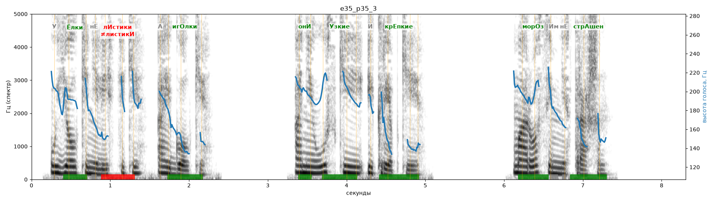

# e35_p35_3

Голос: **edge:ru-RU-SvetlanaNeural** · длительность 8.3 с
Естественность (UTMOS): **4.09 из 5** (живой диктор ≈ 4–4.5)
Эталон: У ёлки не листики, а иголки. Они узкие и крепкие. Мороз им не страшен.
Распознано: У ёлки не листики, а иголки. Они узкие и крепкие. Мороз им не страшен.
Слова: все совпали

## Ударения
(где нужно: ruaccent)

| слово | нужно | у голоса | |
|---|---|---|---|
| ёлки | Ёлки | Ёлки | ✓ |
| листики | лИстики | листикИ | ✗ ОШИБКА |
| иголки | игОлки | игОлки | ✓ |
| они | онИ | онИ | ✓ |
| узкие | Узкие | Узкие | ✓ |
| крепкие | крЕпкие | крЕпкие | ✓ |
| мороз | морОз | морОз | ✓ |
| страшен | стрАшен | стрАшен | ✓ |

## Интонация
- ✓ «у ёлки не листики а иголки.» — конец фразы понижается — звучит законченно
- ✓ «они узкие и крепкие.» — конец фразы понижается — звучит законченно
- ✓ «мороз им не страшен.» — конец фразы понижается — звучит законченно
- Диапазон голоса 7.3 полутонов (живо), средняя высота 186 Гц

## Паузы и темп
- паузы на своих местах
- Темп 6.4 слога/с (нормально)

_Синяя линия — высота голоса. Над словами заглавная буква — где ударение должно быть; красным — голос поставил не туда (уверенно), оранжевым — возможно._
