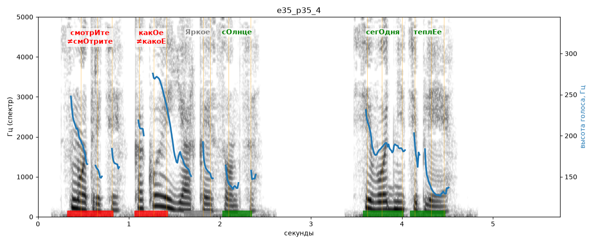

# e35_p35_4

Голос: **edge:ru-RU-SvetlanaNeural** · длительность 5.7 с
Естественность (UTMOS): **3.86 из 5** (живой диктор ≈ 4–4.5)
Эталон: Смотрите, какое яркое солнце! Сегодня теплее.
Распознано: Смотрите, какое яркое солнце. Сегодня теплее.
Слова: все совпали

## Ударения
(где нужно: ruaccent)

| слово | нужно | у голоса | |
|---|---|---|---|
| смотрите | смотрИте | смОтрите | ✗ ОШИБКА |
| какое | какОе | какоЕ | ✗ ОШИБКА |
| яркое | Яркое | — | ? |
| солнце | сОлнце | сОлнце | ✓ |
| сегодня | сегОдня | сегОдня | ✓ |
| теплее | теплЕе | теплЕе | ✓ |

## Интонация
- ✓ «смотрите какое яркое солнце!» — выделено слово «какое» (+8.5 пт)
- ✓ «сегодня теплее.» — конец фразы понижается — звучит законченно
- Диапазон голоса 12.0 полутонов (живо), средняя высота 177 Гц

## Паузы и темп
- паузы на своих местах
- Темп 6.4 слога/с (нормально)

_Синяя линия — высота голоса. Над словами заглавная буква — где ударение должно быть; красным — голос поставил не туда (уверенно), оранжевым — возможно._
