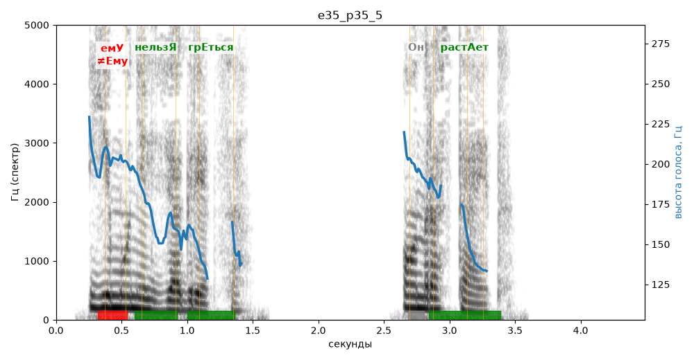

# e35_p35_5

Голос: **edge:ru-RU-SvetlanaNeural** · длительность 4.5 с
Естественность (UTMOS): **3.67 из 5** (живой диктор ≈ 4–4.5)
Эталон: Ему нельзя греться. Он растает.
Распознано: Ему нельзя греться. Он растает.
Слова: все совпали

## Ударения
(где нужно: ruaccent)

| слово | нужно | у голоса | |
|---|---|---|---|
| ему | емУ | Ему | ✗ ОШИБКА |
| нельзя | нельзЯ | нельзЯ | ✓ |
| греться | грЕться | грЕться | ✓ |
| растает | растАет | растАет | ✓ |

## Интонация
- ✓ «ему нельзя греться.» — конец фразы понижается — звучит законченно
- ✓ «он растает.» — конец фразы понижается — звучит законченно
- Диапазон голоса 7.4 полутонов (живо), средняя высота 175 Гц

## Паузы и темп
- паузы на своих местах
- Темп 5.7 слога/с (нормально)

_Синяя линия — высота голоса. Над словами заглавная буква — где ударение должно быть; красным — голос поставил не туда (уверенно), оранжевым — возможно._
