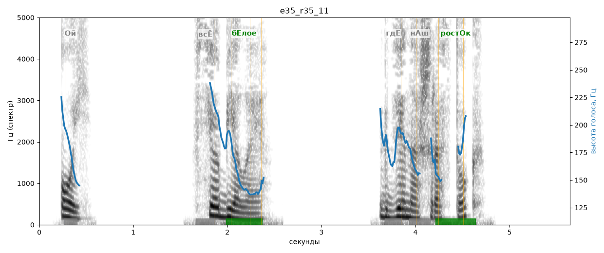

# e35_r35_11

Голос: **edge:ru-RU-SvetlanaNeural** · длительность 5.6 с
Естественность (UTMOS): **3.66 из 5** (живой диктор ≈ 4–4.5)
Эталон: Ой! Всё белое! Где наш росток?
Распознано: Ой! Всё белое! Где наш расток?
Расхождения в словах: «росток» → «расток»

## Ударения
(где нужно: ruaccent)

| слово | нужно | у голоса | |
|---|---|---|---|
| белое | бЕлое | бЕлое | ✓ |
| росток | ростОк | ростОк | ✓ |

## Интонация
- ✓ «всё белое!» — выделено слово «всё» (+5.1 пт)
- ✗ «где наш росток?» — конец фразы не понижается — звучит незаконченно / как перечисление
- Диапазон голоса 7.7 полутонов (живо), средняя высота 174 Гц

## Паузы и темп
- паузы на своих местах
- Темп 5.0 слога/с (нормально)

_Синяя линия — высота голоса. Над словами заглавная буква — где ударение должно быть; красным — голос поставил не туда (уверенно), оранжевым — возможно._
