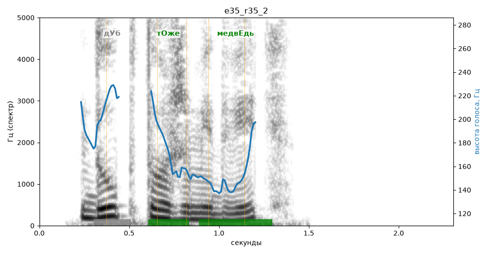

# e35_r35_2

Голос: **edge:ru-RU-SvetlanaNeural** · длительность 2.3 с
Естественность (UTMOS): **3.59 из 5** (живой диктор ≈ 4–4.5)
Эталон: Дуб тоже медведь?
Распознано: Дуб тоже медведь.
Слова: все совпали

## Ударения
(где нужно: ruaccent)

| слово | нужно | у голоса | |
|---|---|---|---|
| тоже | тОже | тОже | ✓ |
| медведь | медвЕдь | медвЕдь | ✓ |

## Интонация
- ✓ «дуб тоже медведь?» — вопросительный подъём на слове «дуб»
- Диапазон голоса 8.3 полутонов (живо), средняя высота 159 Гц

## Паузы и темп
- паузы на своих местах
- Темп 5.0 слога/с (нормально)

_Синяя линия — высота голоса. Над словами заглавная буква — где ударение должно быть; красным — голос поставил не туда (уверенно), оранжевым — возможно._
