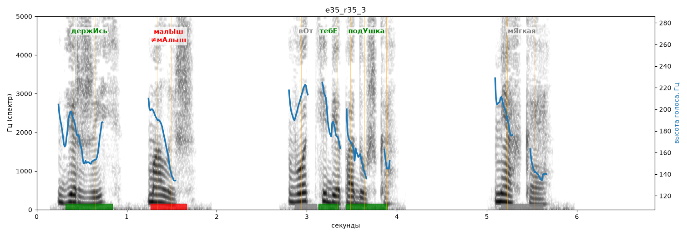

# e35_r35_3

Голос: **edge:ru-RU-SvetlanaNeural** · длительность 6.9 с
Естественность (UTMOS): **3.85 из 5** (живой диктор ≈ 4–4.5)
Эталон: Держись, малыш! Вот тебе подушка. Мягкая!
Распознано: Держись, малыш. Вот тебе подушка. Мягкая.
Слова: все совпали

## Ударения
(где нужно: ruaccent)

| слово | нужно | у голоса | |
|---|---|---|---|
| держись | держИсь | держИсь | ✓ |
| малыш | малЫш | мАлыш | ✗ ОШИБКА |
| тебе | тебЕ | тебЕ | ✓ |
| подушка | подУшка | подУшка | ✓ |
| мягкая | мЯгкая | — | ? |

## Интонация
- ✗ «держись малыш!» — восклицание звучит ровно, без эмоции
- ✓ «вот тебе подушка.» — конец фразы понижается — звучит законченно
- Диапазон голоса 7.6 полутонов (живо), средняя высота 176 Гц

## Паузы и темп
- паузы на своих местах
- Темп 5.0 слога/с (нормально)

_Синяя линия — высота голоса. Над словами заглавная буква — где ударение должно быть; красным — голос поставил не туда (уверенно), оранжевым — возможно._
