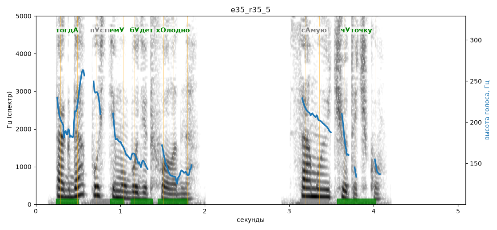

# e35_r35_5

Голос: **edge:ru-RU-SvetlanaNeural** · длительность 5.1 с
Естественность (UTMOS): **3.95 из 5** (живой диктор ≈ 4–4.5)
Эталон: Тогда пусть ему будет холодно! Самую чуточку.
Распознано: Тогда пусть ему будет холодно. Самую чуточку.
Слова: все совпали

## Ударения
(где нужно: ruaccent)

| слово | нужно | у голоса | |
|---|---|---|---|
| тогда | тогдА | тогдА | ✓ |
| ему | емУ | емУ | ✓ |
| будет | бУдет | бУдет | ✓ |
| холодно | хОлодно | хОлодно | ✓ |
| самую | сАмую | — | ? |
| чуточку | чУточку | чУточку | ✓ |

## Интонация
- ✓ «тогда пусть ему будет холодно!» — выделено слово «пусть» (+6.3 пт)
- ✗ «самую чуточку.» — конец фразы не понижается — звучит незаконченно / как перечисление
- Диапазон голоса 9.8 полутонов (живо), средняя высота 179 Гц

## Паузы и темп
- паузы на своих местах
- Темп 6.5 слога/с (нормально)

_Синяя линия — высота голоса. Над словами заглавная буква — где ударение должно быть; красным — голос поставил не туда (уверенно), оранжевым — возможно._
