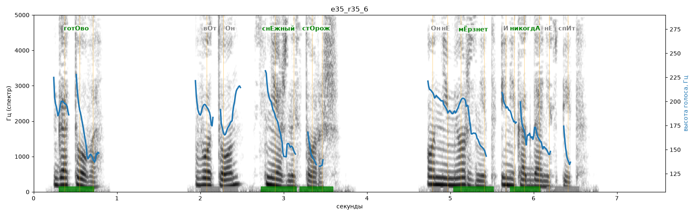

# e35_r35_6

Голос: **edge:ru-RU-SvetlanaNeural** · длительность 7.6 с
Естественность (UTMOS): **3.86 из 5** (живой диктор ≈ 4–4.5)
Эталон: Готово! Вот он, снежный сторож! Он не мёрзнет и никогда не спит!
Распознано: Готово! Вот он, снежный сторож. Он не мерзнет и никогда не спит.
Слова: все совпали

## Ударения
(где нужно: ruaccent)

| слово | нужно | у голоса | |
|---|---|---|---|
| готово | готОво | готОво | ✓ |
| снежный | снЕжный | снЕжный | ✓ |
| сторож | стОрож | стОрож | ✓ |
| мёрзнет | мЁрзнет | мЁрзнет | ✓ |
| никогда | никогдА | никогдА | ✓ |

## Интонация
- ✗ «готово!» — восклицание звучит ровно, без эмоции
- ✓ «вот он снежный сторож!» — выделено слово «вот» (+2.8 пт)
- ✓ «он не мёрзнет и никогда не спит!» — выделено слово «он» (+3.1 пт)
- Диапазон голоса 7.3 полутонов (живо), средняя высота 179 Гц

## Паузы и темп
- паузы на своих местах
- Темп 5.4 слога/с (нормально)

_Синяя линия — высота голоса. Над словами заглавная буква — где ударение должно быть; красным — голос поставил не туда (уверенно), оранжевым — возможно._
