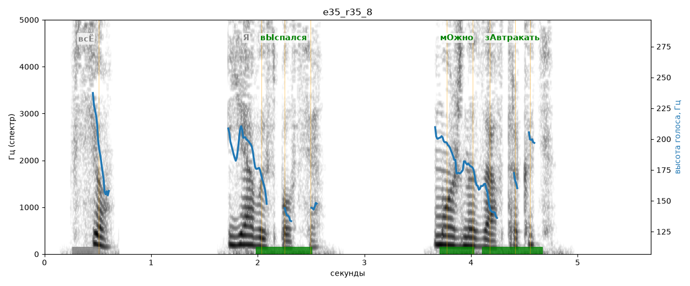

# e35_r35_8

Голос: **edge:ru-RU-SvetlanaNeural** · длительность 5.7 с
Естественность (UTMOS): **3.63 из 5** (живой диктор ≈ 4–4.5)
Эталон: Всё! Я выспался! Можно завтракать?
Распознано: Всё. Я выспался. Можно завтракать?
Слова: все совпали

## Ударения
(где нужно: ruaccent)

| слово | нужно | у голоса | |
|---|---|---|---|
| выспался | вЫспался | вЫспался | ✓ |
| можно | мОжно | мОжно | ✓ |
| завтракать | зАвтракать | зАвтракать | ✓ |

## Интонация
- ✓ «я выспался!» — выделено слово «выспался» (+3.4 пт)
- ✗ «можно завтракать?» — нет вопросительного подъёма (самое высокое место — «можно», в начале) — звучит как утверждение
- Диапазон голоса 7.0 полутонов (живо), средняя высота 178 Гц

## Паузы и темп
- паузы на своих местах
- Темп 4.9 слога/с (нормально)

_Синяя линия — высота голоса. Над словами заглавная буква — где ударение должно быть; красным — голос поставил не туда (уверенно), оранжевым — возможно._
