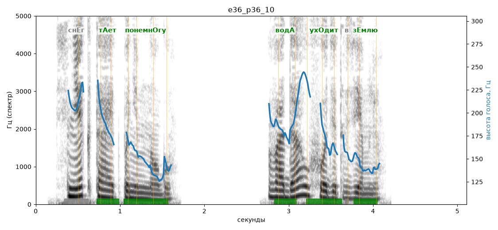

# e36_p36_10

Голос: **edge:ru-RU-SvetlanaNeural** · длительность 5.1 с
Естественность (UTMOS): **3.94 из 5** (живой диктор ≈ 4–4.5)
Эталон: Снег тает понемногу. Вода уходит в землю.
Распознано: Снег тает по немногу. Вода уходит в землю.
Расхождения в словах: «понемногу» → «по немногу»

## Ударения
(где нужно: ruaccent)

| слово | нужно | у голоса | |
|---|---|---|---|
| тает | тАет | тАет | ✓ |
| понемногу | понемнОгу | понемнОгу | ✓ |
| вода | водА | водА | ✓ |
| уходит | ухОдит | ухОдит | ✓ |
| землю | зЕмлю | зЕмлю | ✓ |

## Интонация
- ✓ «снег тает понемногу.» — конец фразы понижается — звучит законченно
- ✓ «вода уходит в землю.» — конец фразы понижается — звучит законченно
- Диапазон голоса 9.8 полутонов (живо), средняя высота 166 Гц

## Паузы и темп
- паузы на своих местах
- Темп 6.1 слога/с (нормально)

_Синяя линия — высота голоса. Над словами заглавная буква — где ударение должно быть; красным — голос поставил не туда (уверенно), оранжевым — возможно._
