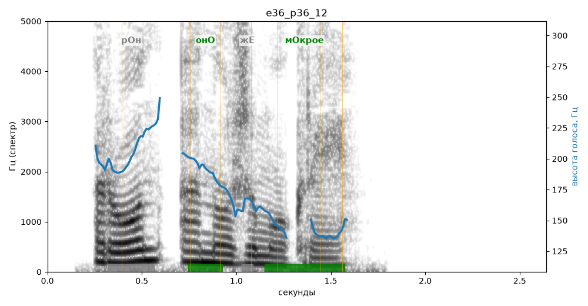

# e36_p36_12

Голос: **edge:ru-RU-SvetlanaNeural** · длительность 2.6 с
Естественность (UTMOS): **3.9 из 5** (живой диктор ≈ 4–4.5)
Эталон: Рон, оно же мокрое!
Распознано: Рон, оно же мокрое.
Слова: все совпали

## Ударения
(где нужно: ruaccent)

| слово | нужно | у голоса | |
|---|---|---|---|
| оно | онО | онО | ✓ |
| мокрое | мОкрое | мОкрое | ✓ |

## Интонация
- ✓ «рон оно же мокрое!» — выделено слово «рон» (+3.5 пт)
- Диапазон голоса 8.6 полутонов (живо), средняя высота 178 Гц

## Паузы и темп
- паузы на своих местах
- Темп 6.6 слога/с (быстро)

_Синяя линия — высота голоса. Над словами заглавная буква — где ударение должно быть; красным — голос поставил не туда (уверенно), оранжевым — возможно._
