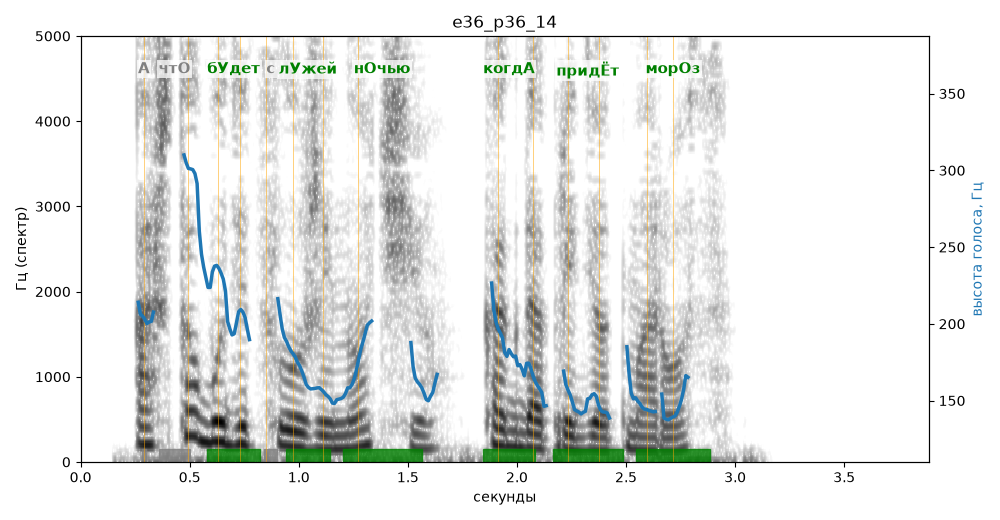

# e36_p36_14

Голос: **edge:ru-RU-SvetlanaNeural** · длительность 3.9 с
Естественность (UTMOS): **3.7 из 5** (живой диктор ≈ 4–4.5)
Эталон: А что будет с лужей ночью, когда придёт мороз?
Распознано: А что будет служи ночью, когда придет мороз?
Расхождения в словах: «с лужей» → «служи»

## Ударения
(где нужно: ruaccent)

| слово | нужно | у голоса | |
|---|---|---|---|
| будет | бУдет | бУдет | ✓ |
| лужей | лУжей | лУжей | ✓ |
| ночью | нОчью | нОчью | ✓ |
| когда | когдА | когдА | ✓ |
| придёт | придЁт | придЁт | ✓ |
| мороз | морОз | морОз | ✓ |

## Интонация
- ✓ «а что будет с лужей ночью когда придёт мороз?» — вопросительный подъём на слове «что»
- Диапазон голоса 9.2 полутонов (живо), средняя высота 166 Гц

## Паузы и темп
- паузы на своих местах
- Темп 6.0 слога/с (нормально)

_Синяя линия — высота голоса. Над словами заглавная буква — где ударение должно быть; красным — голос поставил не туда (уверенно), оранжевым — возможно._
