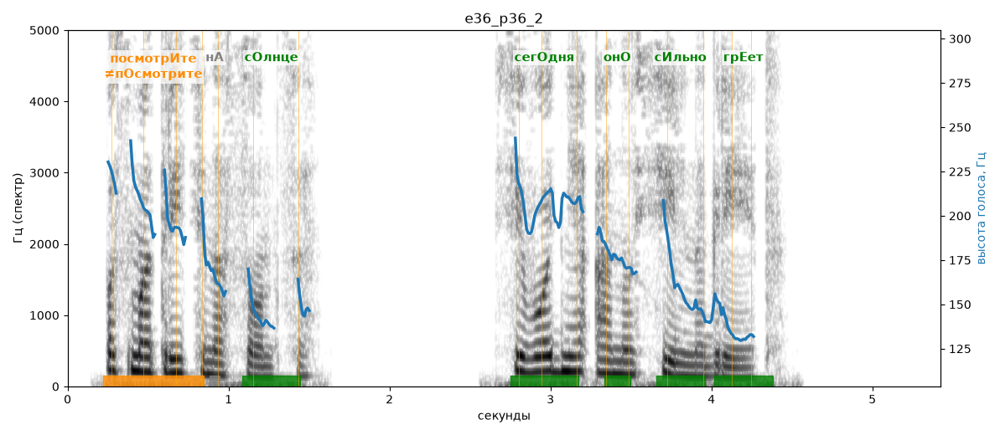

# e36_p36_2

Голос: **edge:ru-RU-SvetlanaNeural** · длительность 5.4 с
Естественность (UTMOS): **3.72 из 5** (живой диктор ≈ 4–4.5)
Эталон: Посмотрите на солнце. Сегодня оно сильно греет.
Распознано: Посмотрите на солнце. Сегодня оно сильно греет.
Слова: все совпали

## Ударения
(где нужно: ruaccent)

| слово | нужно | у голоса | |
|---|---|---|---|
| посмотрите | посмотрИте | пОсмотрите | ✗? возможно — послушать |
| солнце | сОлнце | сОлнце | ✓ |
| сегодня | сегОдня | сегОдня | ✓ |
| оно | онО | онО | ✓ |
| сильно | сИльно | сИльно | ✓ |
| греет | грЕет | грЕет | ✓ |

## Интонация
- ✓ «посмотрите на солнце.» — конец фразы понижается — звучит законченно
- ✓ «сегодня оно сильно греет.» — конец фразы понижается — звучит законченно
- Диапазон голоса 8.7 полутонов (живо), средняя высота 175 Гц

## Паузы и темп
- паузы на своих местах
- Темп 6.3 слога/с (нормально)

_Синяя линия — высота голоса. Над словами заглавная буква — где ударение должно быть; красным — голос поставил не туда (уверенно), оранжевым — возможно._
