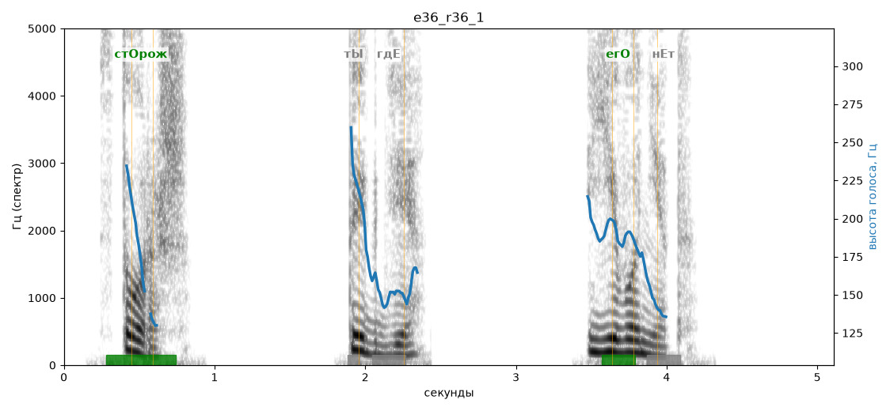

# e36_r36_1

Голос: **edge:ru-RU-SvetlanaNeural** · длительность 5.1 с
Естественность (UTMOS): **3.92 из 5** (живой диктор ≈ 4–4.5)
Эталон: Сторож! Ты где? Его нет!
Распознано: Сторож. Ты где? Его нет.
Слова: все совпали

## Ударения
(где нужно: ruaccent)

| слово | нужно | у голоса | |
|---|---|---|---|
| сторож | стОрож | стОрож | ✓ |
| его | егО | егО | ✓ |

## Интонация
- ✗ «его нет!» — восклицание звучит ровно, без эмоции
- Диапазон голоса 8.6 полутонов (живо), средняя высота 175 Гц

## Паузы и темп
- паузы на своих местах
- Темп 5.1 слога/с (нормально)

_Синяя линия — высота голоса. Над словами заглавная буква — где ударение должно быть; красным — голос поставил не туда (уверенно), оранжевым — возможно._
