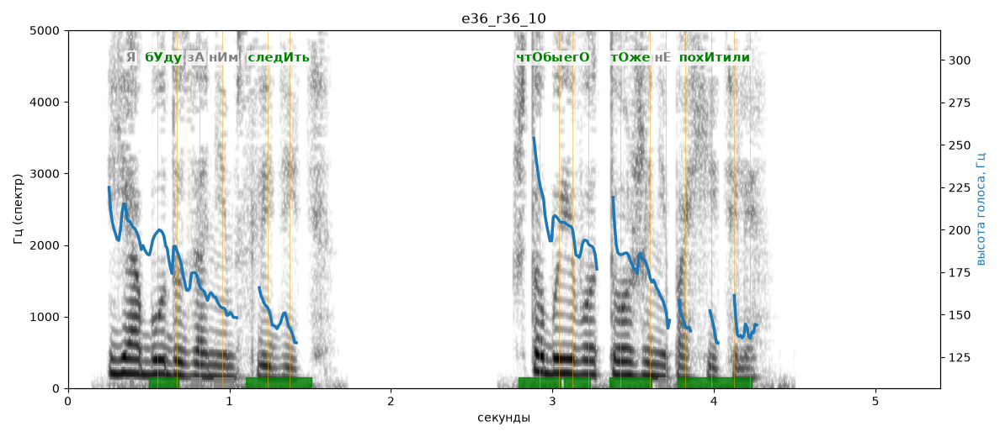

# e36_r36_10

Голос: **edge:ru-RU-SvetlanaNeural** · длительность 5.4 с
Естественность (UTMOS): **3.95 из 5** (живой диктор ≈ 4–4.5)
Эталон: Я буду за ним следить. Чтобы его тоже не похитили.
Распознано: Я буду за ним следить, чтобы его тоже не похитили.
Слова: все совпали

## Ударения
(где нужно: ruaccent)

| слово | нужно | у голоса | |
|---|---|---|---|
| буду | бУду | бУду | ✓ |
| следить | следИть | следИть | ✓ |
| чтобы | чтОбы | чтОбы | ✓ |
| его | егО | егО | ✓ |
| тоже | тОже | тОже | ✓ |
| похитили | похИтили | похИтили | ✓ |

## Интонация
- ✓ «я буду за ним следить.» — конец фразы понижается — звучит законченно
- ✓ «чтобы его тоже не похитили.» — конец фразы понижается — звучит законченно
- Диапазон голоса 7.5 полутонов (живо), средняя высота 177 Гц

## Паузы и темп
- паузы на своих местах
- Темп 6.6 слога/с (быстро)

_Синяя линия — высота голоса. Над словами заглавная буква — где ударение должно быть; красным — голос поставил не туда (уверенно), оранжевым — возможно._
