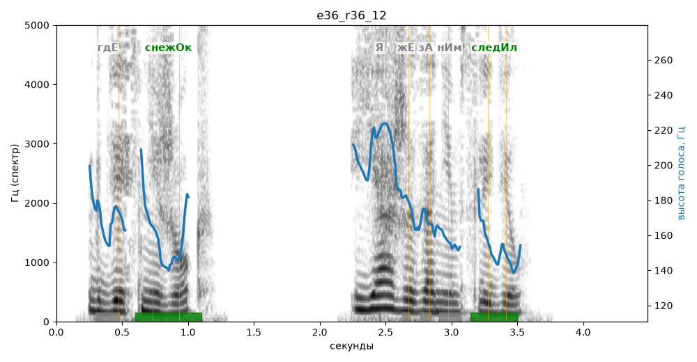

# e36_r36_12

Голос: **edge:ru-RU-SvetlanaNeural** · длительность 4.5 с
Естественность (UTMOS): **3.66 из 5** (живой диктор ≈ 4–4.5)
Эталон: Где снежок? Я же за ним следил!
Распознано: Где снежок? Я же за ним следил.
Слова: все совпали

## Ударения
(где нужно: ruaccent)

| слово | нужно | у голоса | |
|---|---|---|---|
| снежок | снежОк | снежОк | ✓ |
| следил | следИл | следИл | ✓ |

## Интонация
- ✓ «где снежок?» — конец фразы понижается — звучит законченно
- ✓ «я же за ним следил!» — выделено слово «же» (+2.5 пт)
- Диапазон голоса 7.5 полутонов (живо), средняя высота 166 Гц

## Паузы и темп
- паузы на своих местах
- Темп 4.7 слога/с (нормально)

_Синяя линия — высота голоса. Над словами заглавная буква — где ударение должно быть; красным — голос поставил не туда (уверенно), оранжевым — возможно._
