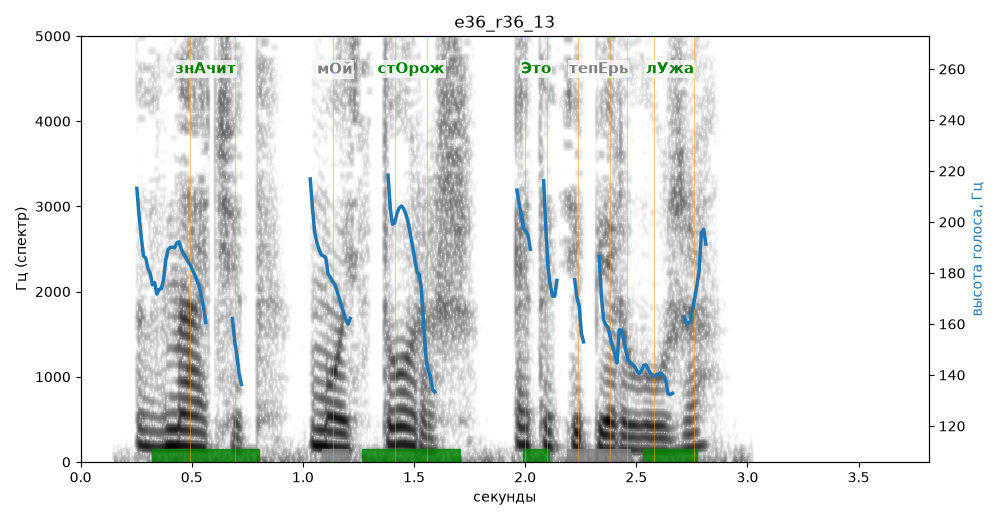

# e36_r36_13

Голос: **edge:ru-RU-SvetlanaNeural** · длительность 3.8 с
Естественность (UTMOS): **3.81 из 5** (живой диктор ≈ 4–4.5)
Эталон: Значит, мой сторож — это теперь лужа?
Распознано: Значит, мой сторож – это теперь лужа.
Слова: все совпали

## Ударения
(где нужно: ruaccent)

| слово | нужно | у голоса | |
|---|---|---|---|
| значит | знАчит | знАчит | ✓ |
| сторож | стОрож | стОрож | ✓ |
| это | Это | Это | ✓ |
| теперь | тепЕрь | — | ? |
| лужа | лУжа | лУжа | ✓ |

## Интонация
- ✓ «значит мой сторож это теперь лужа?» — вопросительный подъём на слове «сторож»
- Диапазон голоса 6.7 полутонов (нормально), средняя высота 175 Гц

## Паузы и темп
- паузы на своих местах
- Темп 6.4 слога/с (нормально)

_Синяя линия — высота голоса. Над словами заглавная буква — где ударение должно быть; красным — голос поставил не туда (уверенно), оранжевым — возможно._
