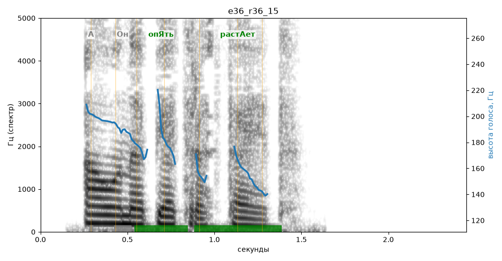

# e36_r36_15

Голос: **edge:ru-RU-SvetlanaNeural** · длительность 2.4 с
Естественность (UTMOS): **3.65 из 5** (живой диктор ≈ 4–4.5)
Эталон: А он опять растает?
Распознано: А он опять растает.
Слова: все совпали

## Ударения
(где нужно: ruaccent)

| слово | нужно | у голоса | |
|---|---|---|---|
| опять | опЯть | опЯть | ✓ |
| растает | растАет | растАет | ✓ |

## Интонация
- ✗ «а он опять растает?» — нет вопросительного подъёма (самое высокое место — «а», в начале) — звучит как утверждение
- Диапазон голоса 6.0 полутонов (нормально), средняя высота 177 Гц

## Паузы и темп
- паузы на своих местах
- Темп 6.3 слога/с (нормально)

_Синяя линия — высота голоса. Над словами заглавная буква — где ударение должно быть; красным — голос поставил не туда (уверенно), оранжевым — возможно._
