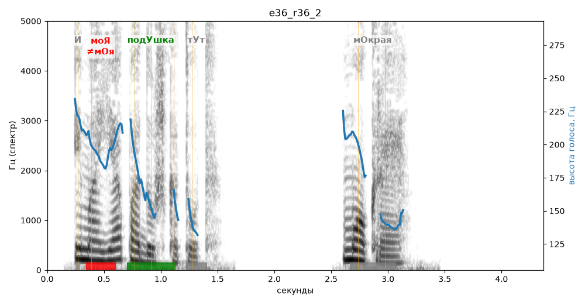

# e36_r36_2

Голос: **edge:ru-RU-SvetlanaNeural** · длительность 4.4 с
Естественность (UTMOS): **4.02 из 5** (живой диктор ≈ 4–4.5)
Эталон: И моя подушка тут. Мокрая!
Распознано: И моя подушка тут. Мокрая.
Слова: все совпали

## Ударения
(где нужно: ruaccent)

| слово | нужно | у голоса | |
|---|---|---|---|
| моя | моЯ | мОя | ✗ ОШИБКА |
| подушка | подУшка | подУшка | ✓ |
| мокрая | мОкрая | — | ? |

## Интонация
- ✓ «и моя подушка тут.» — конец фразы понижается — звучит законченно
- Диапазон голоса 8.2 полутонов (живо), средняя высота 186 Гц

## Паузы и темп
- паузы на своих местах
- Темп 5.2 слога/с (нормально)

_Синяя линия — высота голоса. Над словами заглавная буква — где ударение должно быть; красным — голос поставил не туда (уверенно), оранжевым — возможно._
