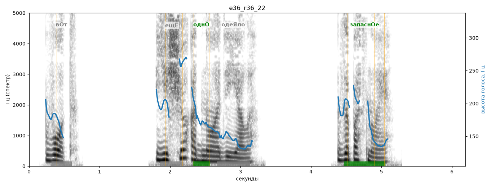

# e36_r36_22

Голос: **edge:ru-RU-SvetlanaNeural** · длительность 6.2 с
Естественность (UTMOS): **4.16 из 5** (живой диктор ≈ 4–4.5)
Эталон: Вот! Ещё одно одеяло. Запасное.
Распознано: Вот. Еще одно одеяло. Запасное.
Слова: все совпали

## Ударения
(где нужно: ruaccent)

| слово | нужно | у голоса | |
|---|---|---|---|
| ещё | ещЁ | Ещё | ? не разобрать |
| одно | однО | однО | ✓ |
| одеяло | одеЯло | — | ? |
| запасное | запаснОе | запаснОе | ✓ |

## Интонация
- ✓ «ещё одно одеяло.» — конец фразы понижается — звучит законченно
- ✓ «запасное.» — конец фразы понижается — звучит законченно
- Диапазон голоса 11.3 полутонов (живо), средняя высота 169 Гц

## Паузы и темп
- паузы на своих местах
- Темп 5.6 слога/с (нормально)

_Синяя линия — высота голоса. Над словами заглавная буква — где ударение должно быть; красным — голос поставил не туда (уверенно), оранжевым — возможно._
