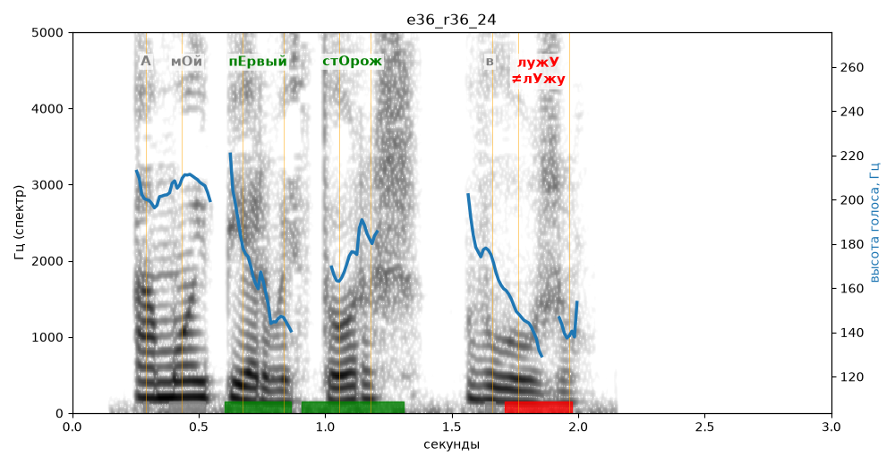

# e36_r36_24

Голос: **edge:ru-RU-SvetlanaNeural** · длительность 3.0 с
Естественность (UTMOS): **3.54 из 5** (живой диктор ≈ 4–4.5)
Эталон: А мой первый сторож — в лужу.
Распознано: А мой первый сторож в лужу.
Слова: все совпали

## Ударения
(где нужно: ruaccent)

| слово | нужно | у голоса | |
|---|---|---|---|
| первый | пЕрвый | пЕрвый | ✓ |
| сторож | стОрож | стОрож | ✓ |
| лужу | лужУ | лУжу | ✗ ОШИБКА |

## Интонация
- ✓ «а мой первый сторож в лужу.» — конец фразы понижается — звучит законченно
- Диапазон голоса 7.1 полутонов (живо), средняя высота 175 Гц

## Паузы и темп
- паузы на своих местах
- Темп 6.6 слога/с (быстро)

_Синяя линия — высота голоса. Над словами заглавная буква — где ударение должно быть; красным — голос поставил не туда (уверенно), оранжевым — возможно._
