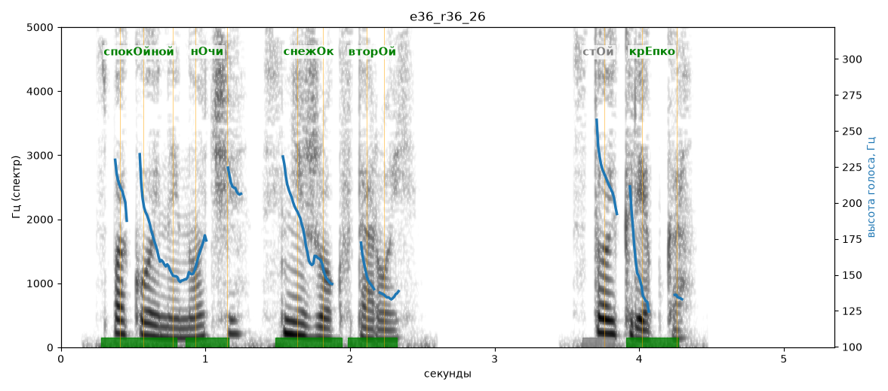

# e36_r36_26

Голос: **edge:ru-RU-SvetlanaNeural** · длительность 5.4 с
Естественность (UTMOS): **3.89 из 5** (живой диктор ≈ 4–4.5)
Эталон: Спокойной ночи, Снежок Второй. Стой крепко.
Распознано: Спокойной ночи, снежок второй. Стой крепко!
Слова: все совпали

## Ударения
(где нужно: ruaccent)

| слово | нужно | у голоса | |
|---|---|---|---|
| спокойной | спокОйной | спокОйной | ✓ |
| ночи | нОчи | нОчи | ✓ |
| снежок | снежОк | снежОк | ✓ |
| второй | вторОй | вторОй | ✓ |
| крепко | крЕпко | крЕпко | ✓ |

## Интонация
- ✓ «спокойной ночи снежок второй.» — конец фразы понижается — звучит законченно
- ✗ «стой крепко.» — конец фразы не понижается — звучит незаконченно / как перечисление
- Диапазон голоса 9.0 полутонов (живо), средняя высота 162 Гц

## Паузы и темп
- паузы на своих местах
- Темп 5.0 слога/с (нормально)

_Синяя линия — высота голоса. Над словами заглавная буква — где ударение должно быть; красным — голос поставил не туда (уверенно), оранжевым — возможно._
