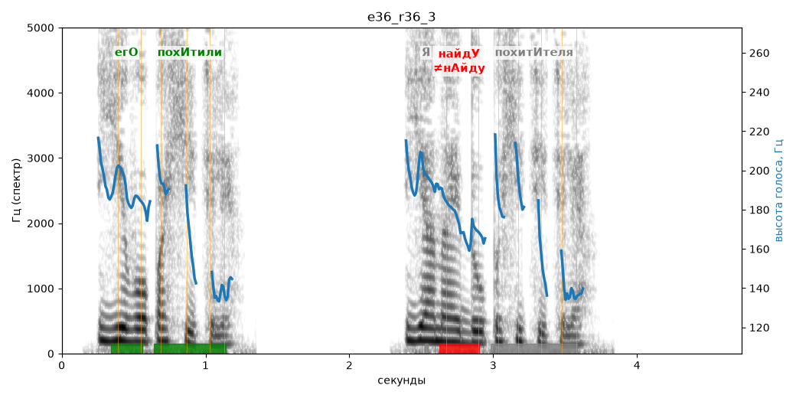

# e36_r36_3

Голос: **edge:ru-RU-SvetlanaNeural** · длительность 4.7 с
Естественность (UTMOS): **3.96 из 5** (живой диктор ≈ 4–4.5)
Эталон: Его похитили! Я найду похитителя!
Распознано: Его похитили. Я найду похитителя.
Слова: все совпали

## Ударения
(где нужно: ruaccent)

| слово | нужно | у голоса | |
|---|---|---|---|
| его | егО | егО | ✓ |
| похитили | похИтили | похИтили | ✓ |
| найду | найдУ | нАйду | ✗ ОШИБКА |
| похитителя | похитИтеля | похитителЯ | ? не разобрать |

## Интонация
- ✗ «его похитили!» — восклицание звучит ровно, без эмоции
- ✗ «я найду похитителя!» — восклицание звучит ровно, без эмоции
- Диапазон голоса 7.4 полутонов (живо), средняя высота 182 Гц

## Паузы и темп
- паузы на своих местах
- Темп 7.0 слога/с (быстро)

_Синяя линия — высота голоса. Над словами заглавная буква — где ударение должно быть; красным — голос поставил не туда (уверенно), оранжевым — возможно._
