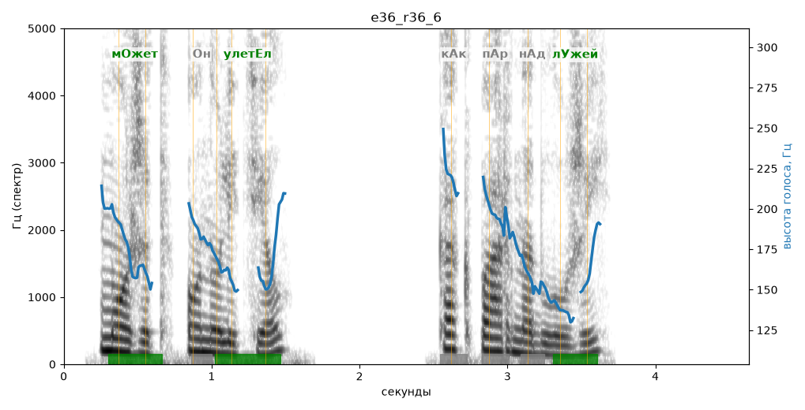

# e36_r36_6

Голос: **edge:ru-RU-SvetlanaNeural** · длительность 4.6 с
Естественность (UTMOS): **3.91 из 5** (живой диктор ≈ 4–4.5)
Эталон: Может, он улетел? Как пар над лужей?
Распознано: Может, он улетел? Как пар над лужей?
Слова: все совпали

## Ударения
(где нужно: ruaccent)

| слово | нужно | у голоса | |
|---|---|---|---|
| может | мОжет | мОжет | ✓ |
| улетел | улетЕл | улетЕл | ✓ |
| лужей | лУжей | лУжей | ✓ |

## Интонация
- ✗ «может он улетел?» — нет вопросительного подъёма (самое высокое место — «может», в начале) — звучит как утверждение
- ✓ «как пар над лужей?» — конец фразы понижается — звучит законченно
- Диапазон голоса 7.7 полутонов (живо), средняя высота 172 Гц

## Паузы и темп
- паузы на своих местах
- Темп 5.4 слога/с (нормально)

_Синяя линия — высота голоса. Над словами заглавная буква — где ударение должно быть; красным — голос поставил не туда (уверенно), оранжевым — возможно._
