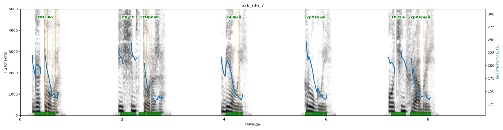

# e36_r36_7

Голос: **edge:ru-RU-SvetlanaNeural** · длительность 9.1 с
Естественность (UTMOS): **3.92 из 5** (живой диктор ≈ 4–4.5)
Эталон: Готово! «Ищем сторожа. Белый. Круглый. Очень храбрый».
Распознано: Готово! Ищем сторожа. Белый. Круглый. Очень храбрый.
Слова: все совпали

## Ударения
(где нужно: ruaccent)

| слово | нужно | у голоса | |
|---|---|---|---|
| готово | готОво | готОво | ✓ |
| ищем | Ищем | Ищем | ✓ |
| сторожа | стОрожа | стОрожа | ✓ |
| белый | бЕлый | бЕлый | ✓ |
| круглый | крУглый | крУглый | ✓ |
| очень | Очень | Очень | ✓ |
| храбрый | хрАбрый | хрАбрый | ✓ |

## Интонация
- ✗ «готово!» — восклицание звучит ровно, без эмоции
- ✗ «ищем сторожа.» — конец фразы не понижается — звучит незаконченно / как перечисление
- ✓ «очень храбрый.» — конец фразы понижается — звучит законченно
- Диапазон голоса 8.6 полутонов (живо), средняя высота 170 Гц

## Паузы и темп
- паузы на своих местах
- Темп 5.8 слога/с (нормально)

_Синяя линия — высота голоса. Над словами заглавная буква — где ударение должно быть; красным — голос поставил не туда (уверенно), оранжевым — возможно._
