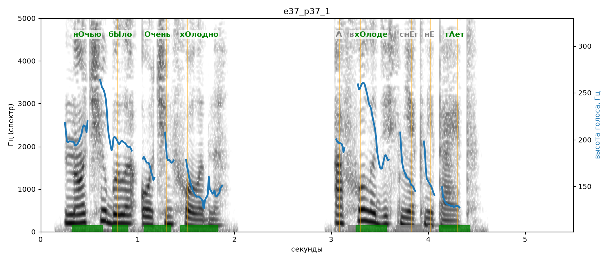

# e37_p37_1

Голос: **edge:ru-RU-SvetlanaNeural** · длительность 5.5 с
Естественность (UTMOS): **4.14 из 5** (живой диктор ≈ 4–4.5)
Эталон: Ночью было очень холодно. А в холоде снег не тает.
Распознано: Ночью было очень холодно. А в холоде снег не тает.
Слова: все совпали

## Ударения
(где нужно: ruaccent)

| слово | нужно | у голоса | |
|---|---|---|---|
| ночью | нОчью | нОчью | ✓ |
| было | бЫло | бЫло | ✓ |
| очень | Очень | Очень | ✓ |
| холодно | хОлодно | хОлодно | ✓ |
| холоде | хОлоде | хОлоде | ✓ |
| тает | тАет | тАет | ✓ |

## Интонация
- ✓ «ночью было очень холодно.» — конец фразы понижается — звучит законченно
- ✓ «а в холоде снег не тает.» — конец фразы понижается — звучит законченно
- Диапазон голоса 11.7 полутонов (живо), средняя высота 179 Гц

## Паузы и темп
- паузы на своих местах
- Темп 6.3 слога/с (нормально)

_Синяя линия — высота голоса. Над словами заглавная буква — где ударение должно быть; красным — голос поставил не туда (уверенно), оранжевым — возможно._
