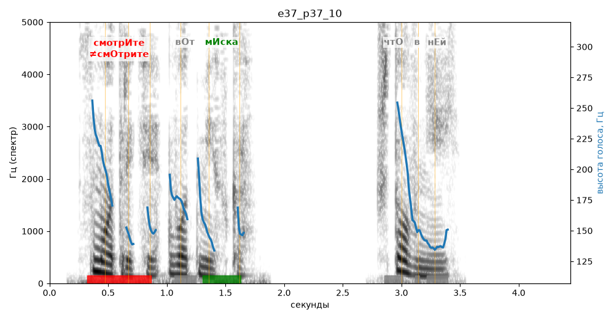

# e37_p37_10

Голос: **edge:ru-RU-SvetlanaNeural** · длительность 4.4 с
Естественность (UTMOS): **3.76 из 5** (живой диктор ≈ 4–4.5)
Эталон: Смотрите, вот миска. Что в ней?
Распознано: Смотрите, вот миска. Что в ней?
Слова: все совпали

## Ударения
(где нужно: ruaccent)

| слово | нужно | у голоса | |
|---|---|---|---|
| смотрите | смотрИте | смОтрите | ✗ ОШИБКА |
| миска | мИска | мИска | ✓ |

## Интонация
- ✗ «смотрите вот миска.» — конец фразы не понижается — звучит незаконченно / как перечисление
- ✓ «что в ней?» — конец фразы понижается — звучит законченно
- Диапазон голоса 9.3 полутонов (живо), средняя высота 157 Гц

## Паузы и темп
- паузы на своих местах
- Темп 5.5 слога/с (нормально)

_Синяя линия — высота голоса. Над словами заглавная буква — где ударение должно быть; красным — голос поставил не туда (уверенно), оранжевым — возможно._
