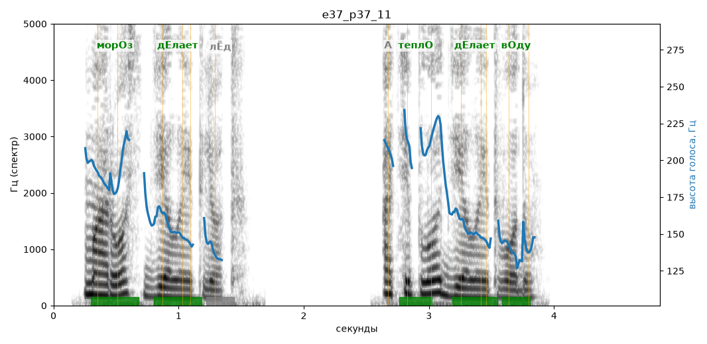

# e37_p37_11

Голос: **edge:ru-RU-SvetlanaNeural** · длительность 4.8 с
Естественность (UTMOS): **3.91 из 5** (живой диктор ≈ 4–4.5)
Эталон: Мороз делает лёд. А тепло делает воду.
Распознано: Мороз делает лёд. А тепло делает воду.
Слова: все совпали

## Ударения
(где нужно: ruaccent)

| слово | нужно | у голоса | |
|---|---|---|---|
| мороз | морОз | морОз | ✓ |
| делает | дЕлает | дЕлает | ✓ |
| тепло | теплО | теплО | ✓ |
| делает | дЕлает | дЕлает | ✓ |
| воду | вОду | вОду | ✓ |

## Интонация
- ✓ «мороз делает лёд.» — конец фразы понижается — звучит законченно
- ✓ «а тепло делает воду.» — конец фразы понижается — звучит законченно
- Диапазон голоса 8.5 полутонов (живо), средняя высота 161 Гц

## Паузы и темп
- паузы на своих местах
- Темп 6.6 слога/с (быстро)

_Синяя линия — высота голоса. Над словами заглавная буква — где ударение должно быть; красным — голос поставил не туда (уверенно), оранжевым — возможно._
