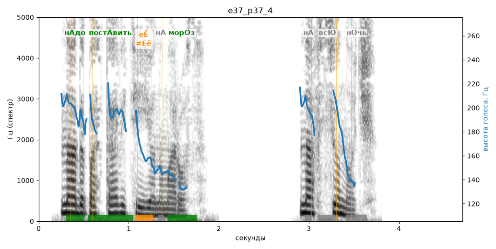

# e37_p37_4

Голос: **edge:ru-RU-SvetlanaNeural** · длительность 4.7 с
Естественность (UTMOS): **3.98 из 5** (живой диктор ≈ 4–4.5)
Эталон: Надо поставить её на мороз. На всю ночь.
Распознано: Надо поставить ее на мороз. На всю ночь.
Слова: все совпали

## Ударения
(где нужно: ruaccent)

| слово | нужно | у голоса | |
|---|---|---|---|
| надо | нАдо | нАдо | ✓ |
| поставить | постАвить | постАвить | ✓ |
| её | еЁ | Её | ✗? возможно — послушать |
| мороз | морОз | морОз | ✓ |

## Интонация
- ✓ «надо поставить её на мороз.» — конец фразы понижается — звучит законченно
- ✓ «на всю ночь.» — конец фразы понижается — звучит законченно
- Диапазон голоса 7.7 полутонов (живо), средняя высота 184 Гц

## Паузы и темп
- паузы на своих местах
- Темп 6.1 слога/с (нормально)

_Синяя линия — высота голоса. Над словами заглавная буква — где ударение должно быть; красным — голос поставил не туда (уверенно), оранжевым — возможно._
