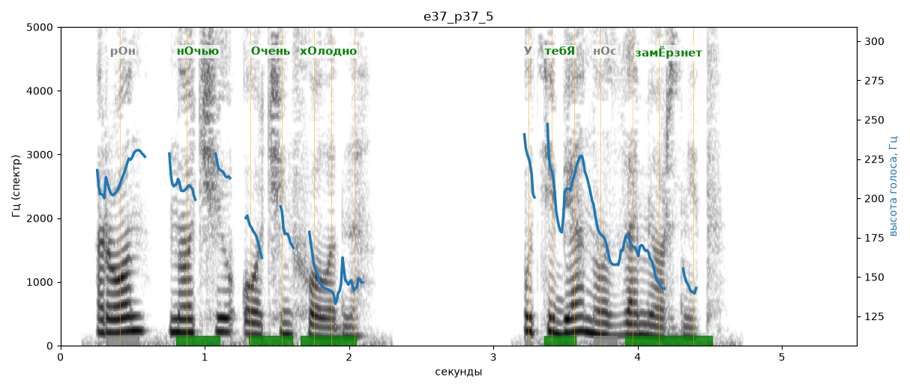

# e37_p37_5

Голос: **edge:ru-RU-SvetlanaNeural** · длительность 5.5 с
Естественность (UTMOS): **3.87 из 5** (живой диктор ≈ 4–4.5)
Эталон: Рон, ночью очень холодно. У тебя нос замёрзнет.
Распознано: Рон, ночью очень холодно. У тебя нос замерзнет.
Слова: все совпали

## Ударения
(где нужно: ruaccent)

| слово | нужно | у голоса | |
|---|---|---|---|
| ночью | нОчью | нОчью | ✓ |
| очень | Очень | Очень | ✓ |
| холодно | хОлодно | хОлодно | ✓ |
| тебя | тебЯ | тебЯ | ✓ |
| замёрзнет | замЁрзнет | замЁрзнет | ✓ |

## Интонация
- ✓ «рон ночью очень холодно.» — конец фразы понижается — звучит законченно
- ✓ «у тебя нос замёрзнет.» — конец фразы понижается — звучит законченно
- Диапазон голоса 8.3 полутонов (живо), средняя высота 181 Гц

## Паузы и темп
- паузы на своих местах
- Темп 5.5 слога/с (нормально)

_Синяя линия — высота голоса. Над словами заглавная буква — где ударение должно быть; красным — голос поставил не туда (уверенно), оранжевым — возможно._
