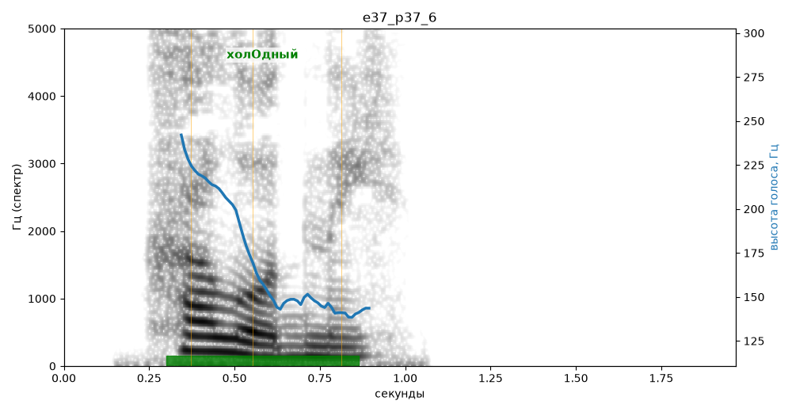

# e37_p37_6

Голос: **edge:ru-RU-SvetlanaNeural** · длительность 2.0 с
Естественность (UTMOS): **4.03 из 5** (живой диктор ≈ 4–4.5)
Эталон: Холодный!
Распознано: Холодный.
Слова: все совпали

## Ударения
(где нужно: ruaccent)

| слово | нужно | у голоса | |
|---|---|---|---|
| холодный | холОдный | холОдный | ✓ |

## Интонация
- ✗ «холодный!» — восклицание звучит ровно, без эмоции
- Диапазон голоса 8.2 полутонов (живо), средняя высота 150 Гц

## Паузы и темп
- паузы на своих местах
- Темп 5.3 слога/с (нормально)

_Синяя линия — высота голоса. Над словами заглавная буква — где ударение должно быть; красным — голос поставил не туда (уверенно), оранжевым — возможно._
