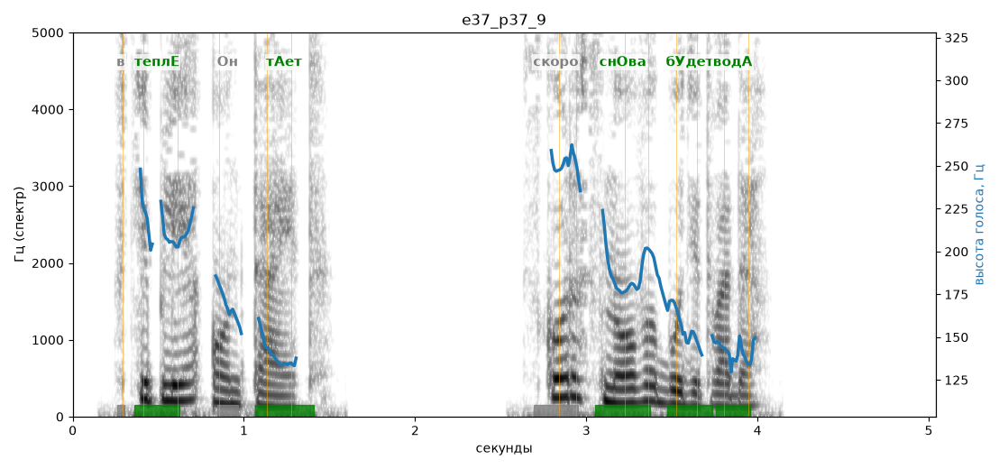

# e37_p37_9

Голос: **edge:ru-RU-SvetlanaNeural** · длительность 5.0 с
Естественность (UTMOS): **3.92 из 5** (живой диктор ≈ 4–4.5)
Эталон: В тепле он тает. Скоро снова будет вода.
Распознано: В тепле он тает. Скоро снова будет вода.
Слова: все совпали

## Ударения
(где нужно: ruaccent)

| слово | нужно | у голоса | |
|---|---|---|---|
| тепле | теплЕ | теплЕ | ✓ |
| тает | тАет | тАет | ✓ |
| скоро | скоро | скОро | нет эталона |
| снова | снОва | снОва | ✓ |
| будет | бУдет | бУдет | ✓ |
| вода | водА | водА | ✓ |

## Интонация
- ✓ «в тепле он тает.» — конец фразы понижается — звучит законченно
- ✓ «скоро снова будет вода.» — конец фразы понижается — звучит законченно
- Диапазон голоса 10.8 полутонов (живо), средняя высота 176 Гц

## Паузы и темп
- паузы на своих местах
- Темп 6.4 слога/с (нормально)

_Синяя линия — высота голоса. Над словами заглавная буква — где ударение должно быть; красным — голос поставил не туда (уверенно), оранжевым — возможно._
