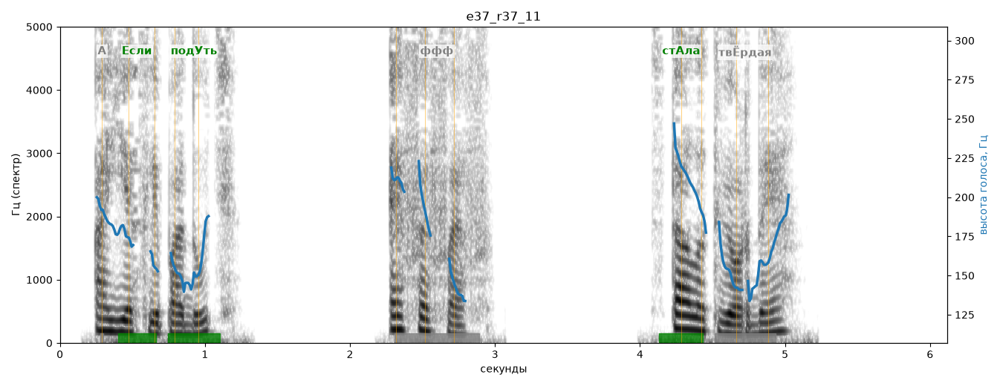

# e37_r37_11

Голос: **edge:ru-RU-SvetlanaNeural** · длительность 6.1 с
Естественность (UTMOS): **3.83 из 5** (живой диктор ≈ 4–4.5)
Эталон: А если подуть? Ффф! Стала твёрдая?
Распознано: А если подуть? FFF Стало твердое
Расхождения в словах: «ффф стала твердая» → «стало твердое»

## Ударения
(где нужно: ruaccent)

| слово | нужно | у голоса | |
|---|---|---|---|
| если | Если | Если | ✓ |
| подуть | подУть | подУть | ✓ |
| стала | стАла | стАла | ✓ |
| твёрдая | твЁрдая | — | ? |

## Интонация
- ✓ «а если подуть?» — вопросительный подъём на слове «а»
- ✗ «стала твёрдая?» — нет вопросительного подъёма (самое высокое место — «стала», в начале) — звучит как утверждение
- Диапазон голоса 7.8 полутонов (живо), средняя высота 174 Гц

## Паузы и темп
- паузы на своих местах
- Темп 5.4 слога/с (нормально)

_Синяя линия — высота голоса. Над словами заглавная буква — где ударение должно быть; красным — голос поставил не туда (уверенно), оранжевым — возможно._
