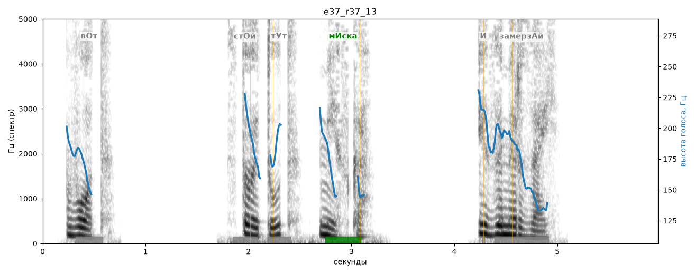

# e37_r37_13

Голос: **edge:ru-RU-SvetlanaNeural** · длительность 6.0 с
Естественность (UTMOS): **3.75 из 5** (живой диктор ≈ 4–4.5)
Эталон: Вот. Стой тут, миска. И замерзай.
Распознано: Вот. Стой тут, миска. Из-за мерзай.
Расхождения в словах: «и замерзай» → «из-за мерзай»

## Ударения
(где нужно: ruaccent)

| слово | нужно | у голоса | |
|---|---|---|---|
| миска | мИска | мИска | ✓ |
| замерзай | замерзАй | зАмерзай | ? не разобрать |

## Интонация
- ✗ «стой тут миска.» — конец фразы не понижается — звучит незаконченно / как перечисление
- ✓ «и замерзай.» — конец фразы понижается — звучит законченно
- Диапазон голоса 8.1 полутонов (живо), средняя высота 181 Гц

## Паузы и темп
- паузы на своих местах
- Темп 5.0 слога/с (нормально)

_Синяя линия — высота голоса. Над словами заглавная буква — где ударение должно быть; красным — голос поставил не туда (уверенно), оранжевым — возможно._
