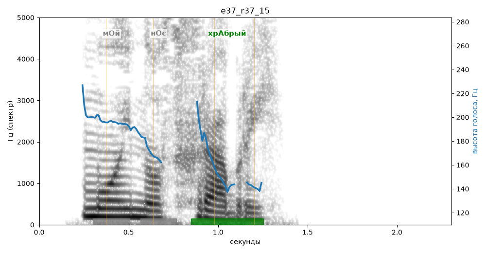

# e37_r37_15

Голос: **edge:ru-RU-SvetlanaNeural** · длительность 2.3 с
Естественность (UTMOS): **3.8 из 5** (живой диктор ≈ 4–4.5)
Эталон: Мой нос храбрый.
Распознано: Мой нос храбрый.
Слова: все совпали

## Ударения
(где нужно: ruaccent)

| слово | нужно | у голоса | |
|---|---|---|---|
| храбрый | хрАбрый | хрАбрый | ✓ |

## Интонация
- ✓ «мой нос храбрый.» — конец фразы понижается — звучит законченно
- Диапазон голоса 6.2 полутонов (нормально), средняя высота 183 Гц

## Паузы и темп
- паузы на своих местах
- Темп 4.2 слога/с (нормально)

_Синяя линия — высота голоса. Над словами заглавная буква — где ударение должно быть; красным — голос поставил не туда (уверенно), оранжевым — возможно._
