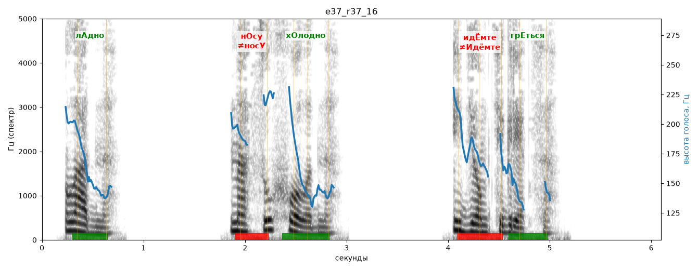

# e37_r37_16

Голос: **edge:ru-RU-SvetlanaNeural** · длительность 6.1 с
Естественность (UTMOS): **3.83 из 5** (живой диктор ≈ 4–4.5)
Эталон: Ладно. Носу холодно. Идёмте греться.
Распознано: Ладно. Носу холодно. Идём тигреться.
Расхождения в словах: «идемте греться» → «идем тигреться»

## Ударения
(где нужно: ruaccent)

| слово | нужно | у голоса | |
|---|---|---|---|
| ладно | лАдно | лАдно | ✓ |
| носу | нОсу | носУ | ✗ ОШИБКА |
| холодно | хОлодно | хОлодно | ✓ |
| идёмте | идЁмте | Идёмте | ✗ ОШИБКА |
| греться | грЕться | грЕться | ✓ |

## Интонация
- ✗ «носу холодно.» — конец фразы не понижается — звучит незаконченно / как перечисление
- ✓ «идёмте греться.» — конец фразы понижается — звучит законченно
- Диапазон голоса 8.4 полутонов (живо), средняя высота 165 Гц

## Паузы и темп
- паузы на своих местах
- Темп 5.6 слога/с (нормально)

_Синяя линия — высота голоса. Над словами заглавная буква — где ударение должно быть; красным — голос поставил не туда (уверенно), оранжевым — возможно._
