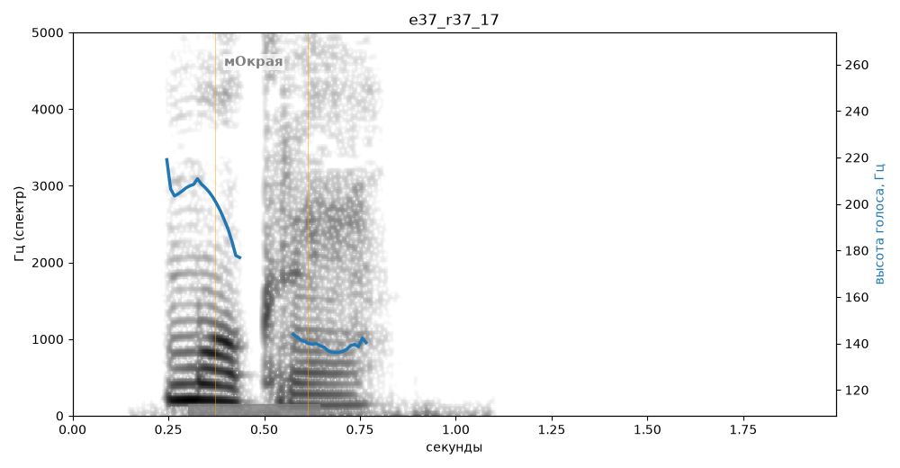

# e37_r37_17

Голос: **edge:ru-RU-SvetlanaNeural** · длительность 2.0 с
Естественность (UTMOS): **3.59 из 5** (живой диктор ≈ 4–4.5)
Эталон: Мокрая!
Распознано: Мокрые
Расхождения в словах: «мокрая» → «мокрые»

## Ударения
(где нужно: ruaccent)

| слово | нужно | у голоса | |
|---|---|---|---|
| мокрая | мОкрая | — | ? |

## Интонация
- Диапазон голоса 7.4 полутонов (живо), средняя высота 160 Гц

## Паузы и темп
- паузы на своих местах
- Темп 5.8 слога/с (нормально)

_Синяя линия — высота голоса. Над словами заглавная буква — где ударение должно быть; красным — голос поставил не туда (уверенно), оранжевым — возможно._
